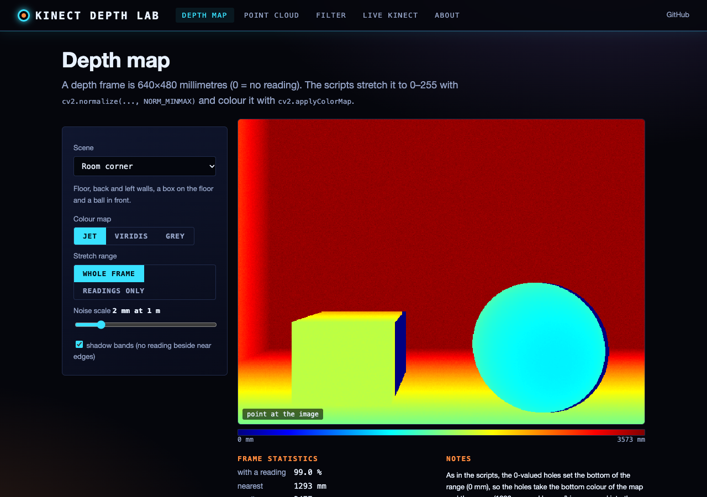
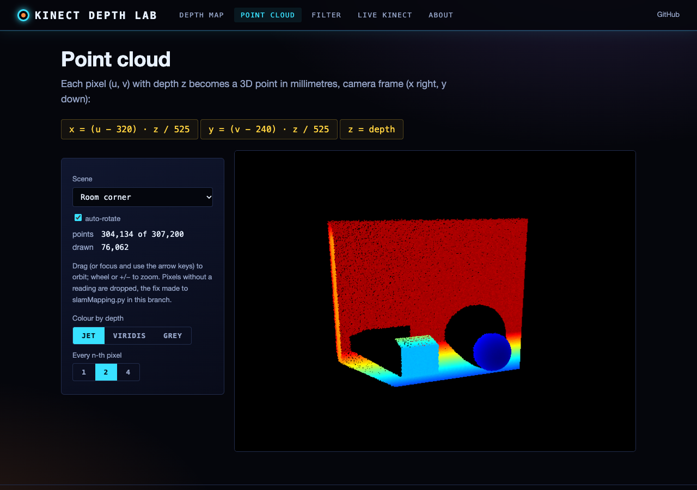
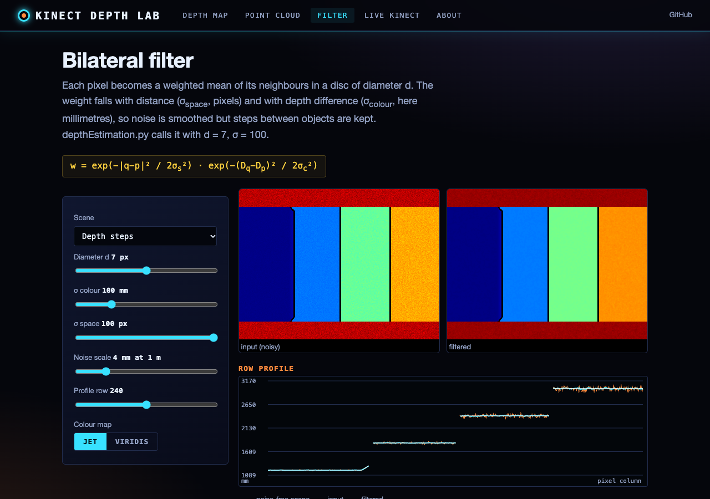

# Depth Estimation & 3D Body Tracking

Real-time depth estimation and human body tracking using a combination of monocular depth models, Kinect Xbox 360 depth sensing, YOLO pose estimation, and facial landmark detection. Supports webcam-only mode and Kinect-enhanced mode with 3D skeleton visualization.

## Features

- **Monocular Depth Estimation (untrained)**: a MobileNetV2-based encoder-decoder that outputs a per-pixel map from a single RGB camera. Only the encoder has (ImageNet) weights; the decoder is built fresh and no trained weights are loaded, so its output is not yet a real depth estimate
- **YOLO-Powered Detection**: Instance segmentation (YOLOv8-seg), pose estimation (YOLOv8-pose), and object classification using Ultralytics models
- **Facial Landmark Detection**: 68-point facial landmark tracking via dlib for detailed face geometry
- **Kinect Integration**: Direct Kinect Xbox 360 depth sensor support via a custom C++/Cython interface (see [kinect_interface](../kinect_interface/))
- **3D Skeleton Visualization**: Real-time 3D body skeleton rendering with PyQt5 and pyqtgraph OpenGL, including face mesh, hand tracking (MediaPipe), and body keypoints
- **Kalman Filtering**: Smooth skeleton position estimation using filterpy Kalman filters
- **SLAM-like Mapping**: Experimental SLAM mapping interface using Kinect depth data
- **Person Tracking**: KCF-based object tracking for consistent person identification across frames

## Project Structure

| File | Description |
|------|-------------|
| `depthEstimation.py` | Main pipeline: YOLO segmentation + dlib face + MobileNetV2 depth + wireframe overlay |
| `_archive/depthEstimation_working.py` | Standalone working version of webcam-based depth estimation (archived) |
| `depthEstimation_kinect.py` | Full Kinect pipeline with 3D skeleton, face mesh, and hand tracking (PyQt5 GUI) |
| `_archive/depthEstimation_kinect_working.py` | Simplified Kinect depth + YOLO segmentation |
| `_archive/depthEstimation_kinect_pyqt5_working.py` | Kinect viewer with PyQt5 display |
| `_archive/depthEstimation_kinect_skeletonTracking_working.py` | Kinect skeleton tracking |
| `_archive/depthEstimation_kinect_skeletonAndFace_working.py` | Kinect skeleton + facial landmarks |
| `_archive/depthEstimation_kinect_skeleton-face-hands_working.py` | Full body + face + hand tracking |
| `skeletonPositionEstimation.py` | Kalman-filtered 3D skeleton position estimation |
| `skeletonTest.py` | Skeleton tracking test/debug utilities |
| `skeleton3D.py` | 3D skeleton rendering with pyqtgraph |
| `skeletonAnimation.py` | Animated 3D skeleton visualization |
| `slamMapping.py` | Experimental SLAM-like mapping with Kinect depth |
| `experiments/animateFBXskeleton.py` | FBX skeleton animation loading |
| `kinect_capture.cpp` / `.h` | C++ backend for Kinect frame capture (shared with kinect_interface) |
| `kinect_wrapper.pyx` | Cython wrapper for the C++ Kinect capture |
| `setup.py` | Build script for the Cython extension |

## Prerequisites

- Python 3.8+
- Kinect Xbox 360 camera (optional, for Kinect-enhanced modes)
- libfreenect (for Kinect support)

### Python Dependencies

```
tensorflow
ultralytics
opencv-python
numpy
dlib
mediapipe
PyQt5
pyqtgraph
pyopengl
scipy
filterpy
```

### Pre-trained Models (included or auto-downloaded)

- `yolov8n-seg.pt` -- instance segmentation
- `yolov8n-pose.pt` -- pose estimation
- `yolov8n.pt`, `yolov8n-cls.pt`, `yolov8n-obb.pt`, `yolov8x.pt`, `yolov8x-cls.pt` -- additional YOLO variants
- `shape_predictor_68_face_landmarks.dat` -- dlib facial landmark model
- `midas_model.pb` -- MiDaS depth estimation model (not loaded by any current script)

## Installation

1. Install system dependencies (macOS):
   ```bash
   brew install libfreenect cmake dlib
   ```

2. Install Python dependencies:
   ```bash
   pip install tensorflow ultralytics opencv-python numpy dlib mediapipe PyQt5 pyqtgraph pyopengl scipy filterpy
   ```

3. Build the Kinect Cython extension (if using Kinect):
   ```bash
   python setup.py build_ext --inplace
   ```

## Usage

### Webcam-Only Depth Estimation
```bash
python depthEstimation.py
```
Runs the full pipeline with webcam: YOLO segmentation, face detection, monocular depth estimation, and wireframe overlay. Press `q` to quit.

### Kinect 3D Skeleton Tracking
```bash
python depthEstimation_kinect.py
```
Launches a PyQt5 GUI with real-time Kinect RGB/depth display and 3D skeleton visualization using pyqtgraph OpenGL. Includes face mesh, hand tracking, and body skeleton.

### Skeleton Position Estimation
```bash
python skeletonPositionEstimation.py
```
Kalman-filtered skeleton position estimation using Kinect depth data for smooth tracking.

## Web interface (Kinect Depth Lab)

Live site: https://gddickinson.github.io/depthEstimation/ (static, runs in the browser).

| Depth map | Point cloud | Bilateral filter |
|---|---|---|
|  |  |  |

The depth maths of the Kinect scripts, factored into `kinect_depth/` (numpy, no hardware) and ported to JavaScript
(node-tested against the Python on every scene):

- **Depth map**: `cv2.normalize(NORM_MINMAX)` + `cv2.applyColorMap` (Jet / Viridis tables taken from OpenCV), with a
  millimetre and x/y read-out under the pointer.
- **Point cloud**: pinhole back-projection with slamMapping.py's f = 525 px and image-centre principal point.
- **Filter**: `cv2.bilateralFilter` with d = 7, sigma 100 (mm) on Kinect depth (depthEstimation.py now uses sigma_color 0.1 on its 0-1 model output), against the noise-free scene.
- **Live Kinect** (local app only): RGB, colourised depth, point cloud and frame statistics streamed from a connected
  Kinect through `kinect_wrapper`; without a device or without the built extension it says why.

The repo has no recorded depth frames, so the pages use **synthetic scenes** (`kinect_depth/scenes.py`: ray-cast planes,
boxes and spheres with illustrative noise and shadow bands, not a calibrated sensor model).

### Run the web app

```bash
pip install -r requirements-web.txt
python run_web.py            # http://127.0.0.1:8155
```

For the Live page also build the extension for the same Python (`python setup.py build_ext --inplace`) and plug in the
Kinect. Tests: `python -m pytest -q tests` and `node web/static/depth_engine.test.mjs`. The static site is built by
`scripts/build_static.py` and published by `.github/workflows/pages.yml` on push to main.

## How It Works

1. **Frame Capture**: RGB frames from webcam or Kinect (with depth)
2. **Object Detection**: YOLOv8 identifies and segments people in the frame
3. **Pose Estimation**: YOLOv8-pose extracts 17 body keypoints
4. **Face Analysis**: dlib detects faces and extracts 68 facial landmarks
5. **Hand Tracking**: MediaPipe identifies hand landmarks (Kinect mode)
6. **Depth Estimation**: Either the (untrained) MobileNetV2 monocular model or the Kinect IR depth sensor
7. **3D Reconstruction**: Combines 2D keypoints with depth data to create 3D skeleton
8. **Visualization**: Side-by-side RGB + depth colormap display, or 3D OpenGL rendering


---
*Built with AI assistance from [Claude (Anthropic)](https://claude.com/).*
